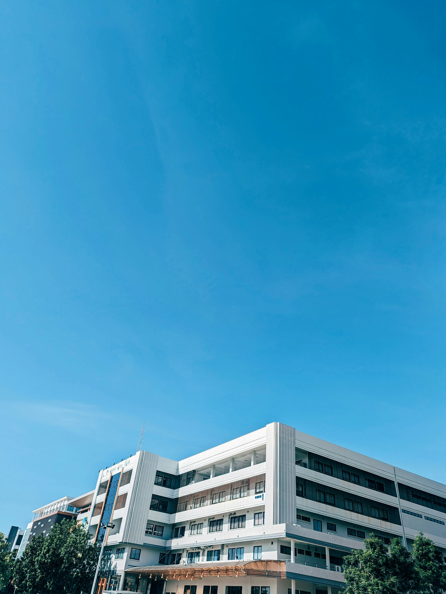
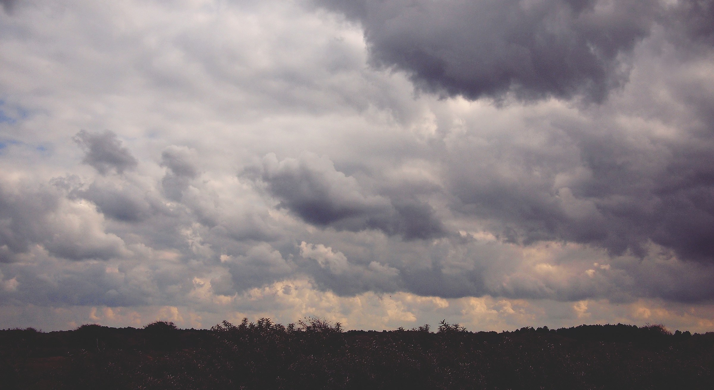

# Sky Pixel

**Classificação da aparência do céu em fotografias diurnas**

O Sky Pixel é um protótipo de processamento digital de imagens em Python. Ele recebe uma fotografia externa e indica se o céu está predominantemente limpo ou encoberto. Quando as pistas visuais são insuficientes ou conflitantes, retorna `indeterminado`. O processamento roda localmente com OpenCV e NumPy.

## Exemplos

| Céu limpo | Céu encoberto | Caso difícil |
| :---: | :---: | :---: |
|  |  |  |
| As duas regras classificam como `ceu_limpo`. | As duas regras classificam como `ceu_encoberto`. | Reflexos nos prédios podem ser marcados pelas máscaras. |

## Como funciona

O programa recorta o terço superior da foto e converte a região para HSV. Em seguida, mede quanto do recorte é azul e quanto é claro com baixa saturação. A regra de referência usa apenas a proporção de azul. A regra combinada considera as duas medidas. A linha de comando mostra o motivo da decisão e pode salvar o recorte e as máscaras.

Nas **20 fotos de teste**, a regra de referência teve 15 acertos, 3 erros e 2 abstenções. A regra combinada teve 9 acertos, 1 erro e 10 abstenções. Nuvens escuras podem produzir poucos pixels na máscara de claros, e prédios ou vegetação no terço superior podem interferir nas medidas.

## Experimente

Com Python 3.10 ou superior e um ambiente virtual ativo, execute a partir da raiz do projeto.

```sh
python -m pip install -r requirements.txt
python main.py refs/teste/ceu_limpo/ceu_limpo_1.jpg --rule both --diagnostics diagnostics/exemplo
```

Troque o caminho da imagem para testar outra foto. O recorte e as máscaras ficam em `diagnostics/exemplo/`.

## Documentação

- [Metodologia, calibração e guia de execução](docs/metodologia.md)
- [Resultados da avaliação e roteiro da demonstração](docs/avaliacao.md)
- [Divisão de trabalho, etapas e critérios de aceite](docs/plano-de-trabalho.md)

**Equipe** — João Victor Moreira Almeida, João Vitor Justiniano Barbosa e Pedro Crispim Pereira.
